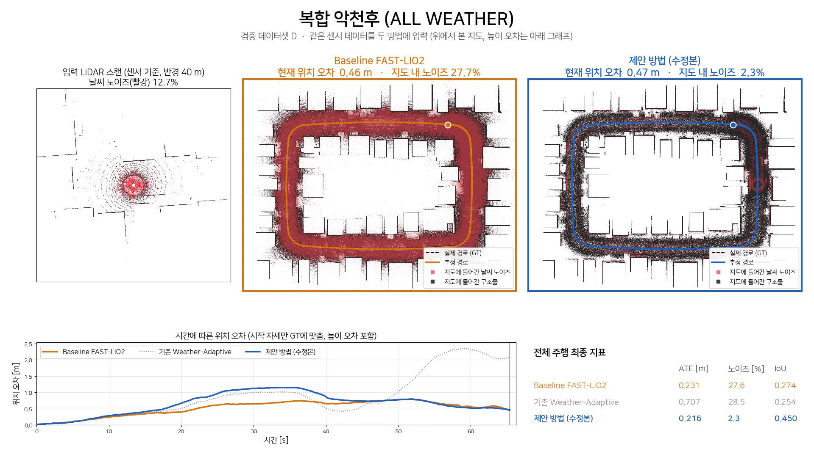
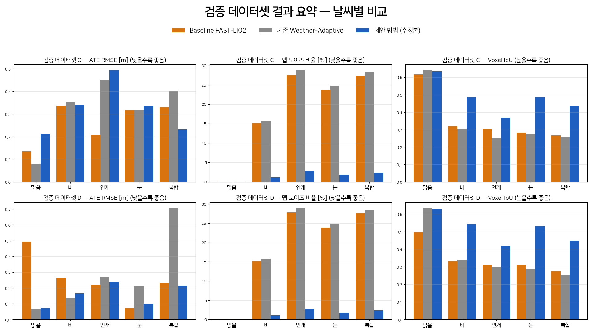
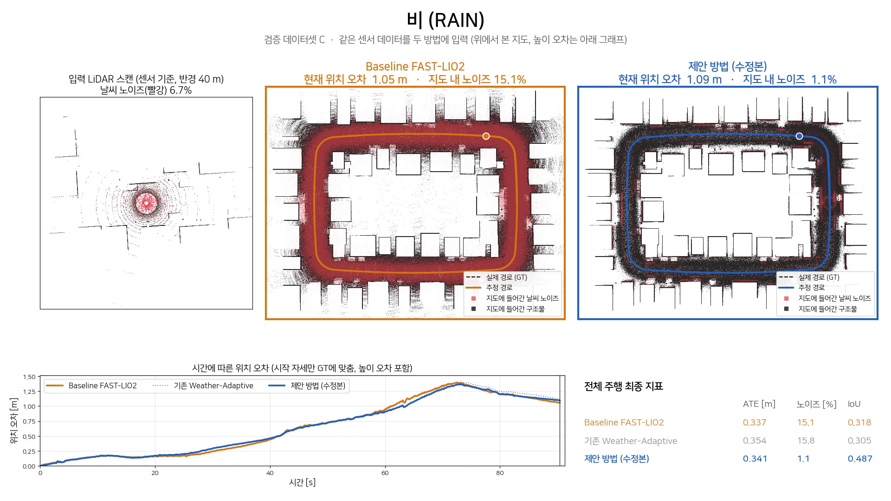

# Weather-Adaptive 3D LiDAR SLAM (FAST-LIO2 기반)

비, 안개, 눈 같은 악천후에서는 LiDAR에 물방울, 눈송이, 후방산란이 만든 **허위 반사점**이 섞입니다. 이 점들이 정합과 지도에 그대로 들어가면 지도가 오염되고 위치 추정이 흔들립니다.

이 프로젝트는 FAST-LIO2(LiDAR–IMU IEKF)에 두 가지를 더해 악천후에서 강인한 SLAM을 목표로 합니다.

- **점 단위 신뢰도**: Fast Point Ranking으로 점마다 신뢰도를 매깁니다.
- **스캔 단위 신뢰도**: 스캔 전체의 신뢰도와 열화도를 계산해 정합과 지도 갱신에 반영합니다.

비교와 평가는 직접 만든 합성 악천후 시뮬레이터에서 했습니다.

> **한 줄 결론**
> 튜닝에 쓰지 않은 검증 데이터에서도 **지도에 들어가는 날씨 노이즈가 약 87% 줄고(0.13배), 지도 정확도(voxel IoU)는 약 45% 올랐습니다.** 10개 조건 모두 같은 방향이었습니다.
> **위치 정확도(ATE)는 baseline과 비슷한 수준(0.91배, 10개 중 4개 우세)입니다.** 기존 adaptive 코드가 복합 악천후에서 발산하던 문제는 해결됐습니다.


*검증 데이터셋 D, 복합 악천후. 같은 센서 데이터를 두 방법에 넣었습니다. 빨간색이 지도에 들어간 날씨 노이즈입니다(baseline 27.6% → 제안 방법 2.3%).*

---

## 1. 방법

### 1.1 처리 흐름

```
LiDAR + IMU
  └─ IMU 전파 (FAST-LIO2)
  └─ Fast Point Ranking: 점 신뢰도 R_k,i  (5×5 range-image 창)
  │     R_k,i = (1 + consistency_i) · range_factor(r_i)
  │     consistency_i = Σ exp(-Δr²/2σ²) / |N|        ← 주변 점과 거리가 일관된 정도 (0~1)
  └─ rank-aware 다운샘플링
  └─ IEKF 정합 (point-to-plane)
  │     점 가중치 w_i = rank 가중치 × Huber
  │     스캔 신뢰도 c_k = α_R·R̃_k + α_N·q_N,k + α_E·q_E,k   → 열화도 D_k = 1 - c_k
  │     (선택) LiDAR 공분산 R_k = R0·(1 + γ·D_k)
  └─ 지도 갱신
        정합용 지도(ikd-tree): 가벼운 필터 (rank 하위 5% 제외)
        출력 지도: 적응형 임계값 τ_k = percentile(consistency, p_k), p_k는 날씨 클러터 비율에 따라 5~60%
```

### 1.2 이 프로젝트에서 바꾼 점 (`weather_reliability.*`)

| 항목 | 기존 adaptive | 제안 방법 | 이유 (실험 근거) |
|---|---|---|---|
| 스캔 신뢰도 c_k | rank 평균, 점 수, 잔차를 고정 기준으로 정규화 | 맑은 날 기준값 R_ref·N_ref로 정규화하고 running max로 보정. 구조 점 수 q_N은 consistency ≥ 0.3인 점만 셈 | 기존 식의 c_k는 날씨 변화에 대한 반응이 약했음 |
| c_k 갱신 시점 | IEKF 반복마다 다시 계산 | **스캔당 한 번 계산 후 고정**(`freeze_confidence`) | 반복 중에 측정 모델이 바뀌어 복합 악천후에서 발산 (ATE 2.59 m) |
| 스캔 가중치 (frame weight) | 점 가중치에 곱함 | 끔. D_k는 공분산 경로로만 반영 | 위와 같은 발산의 원인 |
| 지도 필터 점수 | R_k,i (거리 보정 포함) | **consistency 항만** 사용(`map_on_consistency`) | 거리 보정이 들어가면 가까운 지면 점이 먼저 지워져 z 방향 드리프트 발생 |
| 지도 필터 강도 | 고정 5% | 스캔의 클러터 비율에 따라 **적응형 5~60%** | 날씨가 심할수록 더 많이 걸러야 함 |
| 정합 지도 / 출력 지도 | 하나 | **분리**(`separate_output_map`) | 정합 지도를 강하게 거르면 정합할 점이 부족해져 ATE 악화 |
| 적응 공분산 R0(1+γD_k) | 켬 | **끔** (ablation으로는 유지) | 안개에서는 좋았지만 눈(A)에서 3회 모두 실패 (ATE 1.12 m) |

모든 새 파라미터의 기본값은 꺼짐입니다. 기존 설정 파일로 실행하면 원래 동작이 그대로 재현됩니다(복합 악천후 ATE 2.590 m 동일).

### 1.3 제안서 대비 구현 범위

| 제안서 | 이 저장소 | 비고 |
|---|---|---|
| R_k,i, 가중치, Huber, c_k, D_k, R_lidar, τ_k | 구현함 | 거리 보정항은 실험에서 더 좋았던 `inverse`(1/(1+r/r_max))를 사용 |
| Cartographer 3D 백엔드, loop closure | 구현 안 함 | FAST-LIO2 오도메트리만 사용 |
| 휠 오도메트리 motion prior | 구현 안 함 | IMU prior만 사용 |
| CARLA 악천후 평가 | 구현 안 함 | 자체 합성 시뮬레이터로 대체 |
| ATE, RPE, voxel IoU | 구현함 | 맵 노이즈 비율과 종단 드리프트를 추가 |

---

## 2. 저장소 구조

```
weather_adaptive_fastlio/
├── src/FAST_LIO/                       FAST-LIO2 (ROS 2 Humble) + weather-adaptive 확장
│   ├── src/laserMapping.cpp            rank 가중치, c_k/D_k, weather_reliability, 지도 분리
│   ├── src/rank_cuda.cu                Fast Point Ranking CUDA 커널
│   ├── config/sim_weather_baseline.yaml                     baseline
│   ├── config/sim_weather_weather_adaptive_original.yaml    기존 adaptive
│   ├── config/sim_weather_weather_adaptive.yaml             제안 방법 (최종)
│   ├── config/boreas_rt_*.yaml         실제 데이터(Boreas)용 설정 (이번 변경은 아직 미적용)
│   └── doc/WEATHER_ADAPTIVE_FAST_LIO2.md
├── sim/                                악천후 시뮬레이션 벤치마크 (사용법: sim/README.md)
│   ├── sim_world.py, weather_models.py 장면, 궤적, LiDAR/IMU, 날씨 모델
│   ├── generate_dataset.py             날씨별 rosbag2와 GT 생성
│   ├── run_experiments.sh              방법별 실행
│   ├── evaluate_sim.py                 ATE, RPE, 드리프트, 맵 노이즈, voxel IoU
│   ├── compare_results.py              데이터셋·반복을 합친 비교표
│   ├── render_presentation.py          발표용 비교 영상 (1920×1080, 한글)
│   └── make_highlight.sh               약 1분 40초 하이라이트판
├── scripts/, validation/, results/     로컬 빌드와 Boreas 실행 도구
└── sim_results/                        실험 산출물 (git 제외)
docs/figures/                           README 그림
```

---

## 3. 실험 과정

### 3.1 시뮬레이터

- **장면**: 합성 도심. 건물 약 95~98개와 기둥·나무 90개가 있고, 길이 379 m인 순환 도로를 1.15바퀴 돕니다.
- **센서**:
  - LiDAR: 32채널, 10 Hz, 모션 왜곡 포함, 점마다 `ring`과 `time` 필드
  - IMU: 200 Hz, 노이즈와 바이어스 포함
- **날씨 모델**:

  | 날씨 | 모델 |
  |---|---|
  | 안개 | Beer–Lambert 감쇠와 후방산란 |
  | 비 | 빗방울 반사와 젖은 노면의 반사 손실 |
  | 눈 | 밝은 눈송이 클러터 |
  | 복합 | 위 셋의 혼합. 강도는 시간에 따라 변하고 돌풍 구간이 있음 |

- **데이터셋**:

  | 데이터셋 | 지형 seed | 속도 | 노이즈 seed | 길이 | 용도 |
  |---|---|---|---|---|---|
  | A | 7 | 6 m/s | 0 | 77 s | 개발·튜닝 (3회 반복) |
  | B | 21 | 8 m/s | 1 | 59 s | 개발·튜닝 (2회 반복) |
  | **C** | 33 | 5 m/s | 3 | 92 s | **검증** (튜닝에 사용 안 함) |
  | **D** | 47 | 7 m/s | 5 | 67 s | **검증** (튜닝에 사용 안 함) |

### 3.2 평가 지표

| 지표 | 정의 |
|---|---|
| ATE | SE(3) 정렬 후 위치 RMSE |
| RPE | 10 m 구간의 상대 병진 오차 [%]와 회전 오차 [deg/10 m] |
| 종단 드리프트 | 첫 자세만 GT에 맞췄을 때 마지막 위치의 오차 |
| 맵 노이즈 비율 | 출력 지도 후보 점 가운데 실제 표면에서 0.3 m 넘게 떨어진 점의 비율. 프레임별 자세 오차를 제거한 뒤 판정하므로 날씨 아티팩트만 셈 |
| Voxel IoU | 0.5 m voxel 기준으로, 추정 지도와 GT 레이캐스트 지도가 겹치는 비율 |

### 3.3 진행 단계

1. **기준 벤치마크** (데이터셋 A)
   - 기존 adaptive는 맑음, 비, 눈에서 baseline보다 나았습니다.
   - 하지만 복합 악천후에서는 z 방향으로 약 7 m 드리프트했습니다(ATE 2.59 m, 3회 모두 재현).
   - 지도 필터는 날씨 점을 거의 걸러내지 못했습니다(맵 노이즈 약 29%).
2. **원본을 건드리지 않은 개선안 ablation** (V1~V5, 별도 빌드)
   - c_k 신호 개선(V1)과 스캔 가중치 고정(V5)은 기존 대비 ATE를 0.76~0.79배로 줄였습니다.
   - 지도를 강하게 거르는 안(V4)은 노이즈를 0.13배로 줄였지만 ATE가 2.2배로 나빠졌습니다.
   - 즉 **"지도를 깨끗하게 하는 것"과 "정합을 안정적으로 하는 것"이 서로 충돌**했습니다.
3. **제안서와 코드 비교, 1차 구현**
   - 제안서의 c_k, D_k, τ_k 식을 구현했습니다.
   - 분석한 결과, 점 신뢰도 R_k,i는 날씨 점을 잘 구분했습니다(AUC 0.98~0.99).
   - 하지만 R_k,i에는 거리 보정이 들어 있어서, 이 값의 percentile로 거르면 가까운 지면 점부터 사라졌습니다. 그래서 지도 필터에는 거리 보정을 뺀 consistency 항만 쓰기로 했습니다.
   - 1차 구현은 노이즈는 줄였지만 ATE가 기존과 비슷하거나 나빴습니다(기존 대비 1.73배).
4. **실패 원인 수정 (최종안)**
   - 정합 지도와 출력 지도를 분리했습니다.
   - c_k를 스캔당 한 번만 계산하고 스캔 가중치를 껐습니다.
   - 적응 공분산은 눈(A)에서 실패해서 끄고, ablation(`proposed_cov`)으로만 남겼습니다.
5. **검증 데이터셋 C·D 평가**
   - 파라미터를 하나도 바꾸지 않고, 튜닝에 쓰지 않은 새 장면에서 다시 평가했습니다.

---

## 4. 실험 결과

### 4.1 개발 데이터 (A 3회, B 2회 평균): 튜닝에 사용한 데이터

| 날씨 | Baseline ATE [m] | 기존 adaptive | **제안 방법** | 맵 노이즈 % (baseline → 제안) | IoU (baseline → 제안) |
|---|---|---|---|---|---|
| 맑음 | 0.35 / 0.45 | 0.05 / 0.11 | 0.05 / 0.12 | 0.08 → 0.07 | 0.53 → 0.66 |
| 비 | 0.72 / 0.91 | 0.10 / 0.50 | 0.21 / 0.40 | 15.2 → 1.2 | 0.30 → 0.53 |
| 안개 | 0.25 / 0.46 | 0.26 / 0.30 | 0.26 / 0.48 | 28.3 → 3.1 | 0.31 → 0.42 |
| 눈 | 0.32 / 0.23 | 0.22 / 0.15 | 0.25 / 0.15 | 24.1 → 2.0 | 0.28 → 0.51 |
| 복합 | 1.02 / 0.34 | **2.59** / 0.55 | **0.26 / 0.16** | 27.9 → 2.5 | 0.23 → 0.43 |

*ATE는 "A / B" 순서이고, 맵 노이즈와 IoU는 데이터셋 A의 값입니다.*

개발 데이터의 기하평균 비율 (10셀):

| | ATE | 맵 노이즈 | IoU |
|---|---|---|---|
| 제안 방법 vs baseline | 0.45배 (8/10) | 0.14배 (10/10) | 1.61배 (10/10) |
| 제안 방법 vs 기존 adaptive | 0.79배 (5/10) | 0.14배 (10/10) | 1.58배 (8/10) |

### 4.2 검증 데이터 (C, D): 튜닝에 사용하지 않은 데이터

| 데이터 | 날씨 | ATE [m] B / 기존 / **제안** | 맵 노이즈 % B / **제안** | IoU B / **제안** |
|---|---|---|---|---|
| C | 맑음 | 0.134 / 0.081 / 0.214 | 0.05 / 0.04 | 0.62 / 0.63 |
| C | 비 | 0.337 / 0.354 / 0.341 | 15.1 / **1.2** | 0.32 / **0.49** |
| C | 안개 | 0.208 / 0.449 / 0.494 | 27.6 / **2.8** | 0.30 / **0.37** |
| C | 눈 | 0.317 / 0.317 / 0.335 | 23.8 / **1.9** | 0.28 / **0.48** |
| C | 복합 | 0.329 / 0.402 / **0.232** | 27.4 / **2.4** | 0.27 / **0.43** |
| D | 맑음 | 0.492 / 0.068 / 0.072 | 0.06 / 0.05 | 0.50 / 0.63 |
| D | 비 | 0.264 / 0.134 / 0.166 | 15.2 / **1.1** | 0.33 / **0.54** |
| D | 안개 | 0.221 / 0.273 / 0.239 | 27.8 / **2.8** | 0.31 / **0.42** |
| D | 눈 | 0.072 / 0.213 / 0.101 | 23.9 / **1.8** | 0.31 / **0.53** |
| D | 복합 | 0.231 / **0.707** / **0.216** | 27.6 / **2.3** | 0.27 / **0.45** |

*B는 baseline, 기존은 기존 adaptive입니다.*

검증 데이터의 기하평균 비율 (10셀, 괄호는 우세한 셀 수):

| 제안 방법 | ATE | 드리프트 | RPE (병진) | RPE (회전) | 맵 노이즈 | IoU | 처리 시간 |
|---|---|---|---|---|---|---|---|
| vs baseline | 0.91 (4/10) | 1.03 (4/10) | 0.90 (6/10) | **0.76 (8/10)** | **0.13 (10/10)** | **1.45 (10/10)** | 1.10배 |
| vs 기존 adaptive | 0.88 (5/10) | 0.84 (5/10) | 0.98 (7/10) | 0.92 (8/10) | **0.13 (10/10)** | **1.48 (8/10)** | 1.02배 |

최악 ATE는 baseline 0.492 m, 기존 adaptive 0.707 m, 제안 방법 0.494 m였습니다.




*검증 데이터셋 C, 비. 궤적 오차는 세 방법이 거의 같지만, 지도에 들어간 날씨 노이즈는 15.1%에서 1.1%로 줄었습니다.*

---

## 5. 고찰

### 5.1 개선점

| 항목 | 결과 (검증 데이터 C·D, baseline 대비) |
|---|---|
| 지도 노이즈 감소 | 맵 노이즈 **0.13배**, voxel IoU **1.45배**. 10개 조건 모두 개선되었고, 개발 데이터(0.14배, 1.61배)와도 비슷해 장면이 바뀌어도 효과가 유지됨 |
| 발산 제거 | 기존 adaptive가 복합 악천후에서 크게 드리프트하던 문제(A 2.59 m, D 0.71 m)를 해결. 모든 조건에서 ATE 0.5 m 이하 |
| 회전 안정성 | 회전 RPE **0.76배** (8/10) |
| 호환성 | 새 파라미터를 끄면 기존 결과가 그대로 재현되어 회귀 위험 없음 |

### 5.2 한계 및 보완

| 한계 | 보완 방향 |
|---|---|
| **위치 정확도는 baseline과 비슷한 수준.** 검증 데이터 ATE 0.91배(4/10). 개발 데이터의 0.45배는 같은 데이터로 튜닝한 탓에 과대평가된 값임 | 정합용 지도에도 노이즈 제거 적용 (아래 항목) |
| **정합용 지도에는 노이즈가 남아 있음.** 노이즈 제거가 출력 지도에만 적용돼서, 정합 경로는 사실상 바뀌지 않았음 | 연속 2스캔 이상 관측된 점만 ikd-tree에 넣는 시간 지속성 필터 (날씨 입자는 같은 위치에 다시 나타나지 않음) |
| **안개에 약함.** 데이터셋 4개 모두에서 baseline보다 나빴고, C에서는 0.21 → 0.49 m로 크게 나빠짐 | 센서 근처 후방산란 클러터가 점 가중치에 미치는 영향 분석 |
| **적응 공분산 R0(1+γD_k)이 불안정.** 안개에서는 좋았지만(0.26 → 0.15 m) 눈에서 발산(1.12 m)해서 꺼 둠 | 공분산 증가 상한, 누적 기준값 대비 D_k 사용, 시간 평활화 |
| **시뮬레이션만으로 검증.** 단순화된 장면과 날씨 모델, 장면 4개, 같은 형태의 경로 | Boreas 악천후 시퀀스로 검증. R_ref·N_ref는 센서별로 다시 보정 |
| **제안서 구성 일부 미구현.** Cartographer 백엔드, loop closure, 휠 오도메트리 prior | 휠 오도메트리 prior와 loop closure 추가 |

## 6. 재현 방법

```bash
# 빌드 (Ubuntu 22.04, ROS 2 Humble, Livox ROS driver 2 필요: weather_adaptive_fastlio/LOCAL_SETUP.md 참고)
cd weather_adaptive_fastlio
source /opt/ros/humble/setup.bash && source ~/ws_livox/install/setup.bash
colcon build --base-paths src --packages-select fast_lio --cmake-args -DCMAKE_BUILD_TYPE=Release

# 검증 데이터셋 C 생성 → 실행 → 평가 (데이터셋당 약 45분, 약 5 GB)
cd sim
python3 generate_dataset.py --out ../sim_results/valC/data --world-seed 33 --speed 5.0 --seed-offset 3
RES=$PWD/../sim_results/valC METHODS="baseline original proposed" ./run_experiments.sh
python3 evaluate_sim.py --results ../sim_results/valC --modes baseline original proposed
python3 compare_results.py --dataset C=../sim_results/valC

# 발표 영상
python3 render_presentation.py --results ../sim_results/valC --labels "검증 데이터셋 C" --out ../sim_results/presentation
./make_highlight.sh ../sim_results/presentation
```

자세한 옵션은 [sim/README.md](weather_adaptive_fastlio/sim/README.md)에 있습니다.
